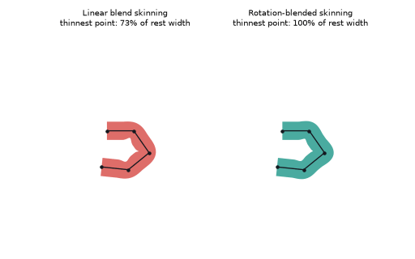
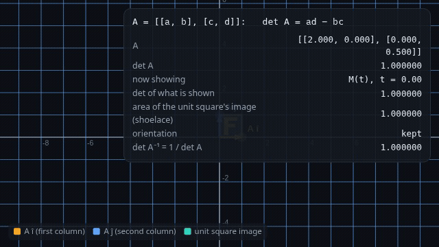

# What you are building toward

A four-bone arm waves while two skins follow it. On the left, plain linear blend skinning pinches the joints: its thinnest point shrinks to about two thirds of the rest width. On the right, a rotation-aware skin keeps its full width. Your goal over the coming sessions: build that right-hand side yourself, then take it into 3D.

*Target: linear blend skinning (left) versus a width-keeping skin (right)*

- [Shear transform: how a matrix deforms a shape (video)](media/shear_transform.mp4)

- [Rotate-then-scale is not scale-then-rotate (video)](media/order_matters.mp4)

*Math Visual Studio: morphing a shape with a matrix*

These results come from a private reference build. The code is not published; the roadmap shows the path so you can build your own.

Live links:

- [Math Visual Studio: matrices as transformations (Atlas S20)](https://krunalpanchal1995.github.io/studio/#atlas?ch=S20&ex=1)
- [Math Visual Studio: deformers and skinning (Atlas S109)](https://krunalpanchal1995.github.io/studio/#atlas?ch=S109&ex=1)
