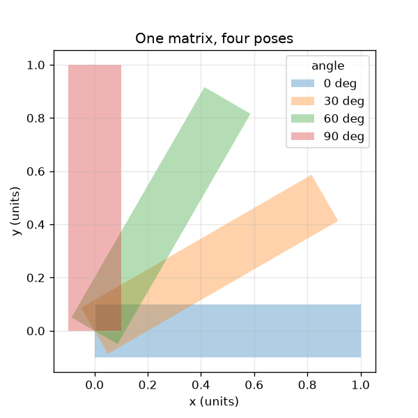
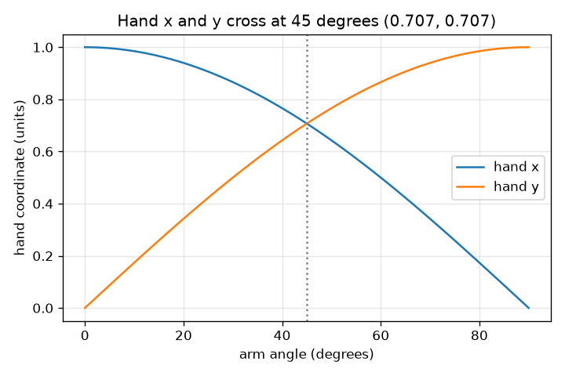

# Session 1: One matrix moves a whole arm

*Level 1 (conceptual interactive model) · about 60 minutes · openvfx*

> This is a simplified educational model. It is not a validated design tool and must not be used for real structures, electrical installations, vehicles, industrial processes or medical decisions.

**Prerequisites**

- School trigonometry: sine and cosine.
- You have read PRIMER.md and run `python start.py 1` once.

**Learning objectives.** After this session you can:

- Explain what a rotation matrix does to a point.
- Use R @ p to compute where a point lands, by hand and in Python.
- Show that a rotation never changes length or area.
- Read a graph of hand x and y against angle.

## A. Real-world problem
Every frame of an animated film moves thousands of points on a character. Nobody moves them one at a time: one matrix moves them all at once. When a character waves, the arm must swing round without stretching or shrinking. How do we write 'turn everything by 30 degrees' so that a computer can do it for every point?

## B. Concept and theory
A point is a pair of coordinates (x, y). Rotating it counter-clockwise by an angle theta about the origin gives new coordinates found from the rotation matrix R(theta). Multiplying a matrix by a point means: each new coordinate is a row of the matrix multiplied term by term with (x, y) and added. The two columns of R are unit-length and perpendicular, which is why R keeps lengths and angles; its determinant 1 says that area is kept too.

| Symbol | Meaning | Unit |
|---|---|---|
| theta | rotation angle, counter-clockwise | degrees or radians |
| (x, y) | coordinates of a point | units (any length unit) |
| R | rotation matrix | no unit |
| L | arm length (distance shoulder to hand) | units |

**Assumptions**

- The arm is a rigid shape: it can turn but not stretch.
- Angles are measured counter-clockwise from the x axis.
- The shoulder is at the origin (0, 0).

$$ R(\theta)=\begin{pmatrix}\cos\theta & -\sin\theta\\ \sin\theta & \cos\theta\end{pmatrix} $$

$$ \begin{pmatrix}x'\\ y'\end{pmatrix}=R(\theta)\begin{pmatrix}x\\ y\end{pmatrix}=\begin{pmatrix}x\cos\theta-y\sin\theta\\ x\sin\theta+y\cos\theta\end{pmatrix} $$

$$ R(\theta)^{\mathsf T}R(\theta)=I\quad\text{(columns are unit length and perpendicular, so lengths are kept)} $$

$$ \det R(\theta)=\cos^2\theta+\sin^2\theta=1\quad\text{(area is kept)} $$

## C. Visual explanation
The left figure shows one arm turned to four angles by the same matrix; every pose has the same length and thickness. The right figure plots where the hand lands as the angle grows: its x coordinate follows the cosine curve and its y coordinate the sine curve. The two curves cross at 45 degrees where the hand is at (0.707, 0.707).

*One matrix, four poses: the arm keeps its length and thickness.*

*Hand x and y against angle: cosine and sine curves cross at 45 degrees.*

## D. Interactive simulation
Run the lesson (`python start.py 1`), then open the live app: [Session 1: rotate the arm](https://krunalpanchal1995.github.io/openvfx/session-01/) (or `app.html` in this folder). Drag the angle slider and watch the hand trace the dashed circle of radius 1, then switch to the graph view and see x and y follow cosine and sine.

**Challenge.** Point the hand straight up, at (0, 1).

## E. Worked example and experiment
**Problem.** Where does the hand end up after the arm (length 1, pointing along x) is turned by 30 degrees? Check that the length is still 1.

1. The hand starts at (1, 0). For 30 degrees, cos = 0.866 and sin = 0.500.
2. New x = 0.866 * 1 - 0.500 * 0 = 0.866.
3. New y = 0.500 * 1 + 0.866 * 0 = 0.500.
4. Length = sqrt(0.866^2 + 0.500^2) = sqrt(0.750 + 0.250) = sqrt(1.000) = 1.

**Answer.** The hand lands at (0.866, 0.500) and the length is still 1.

**Experiment.** Draw a unit arm on squared paper, turn it 30 degrees with a protractor and read the hand coordinates; you should get about (0.87, 0.50). Compare with the app readout and with checkpoint.py. Any small difference comes from reading a protractor, not from the maths: the model is exact, the paper is not.

## F. Assessment and design challenge
**Question type A: Conceptual.** Why can a rotation never stretch the arm? What would a matrix that stretched the arm have to look like?

Hint

Look at the length of each column of R, and ask what the determinant does and does not tell you.

Step-by-step solution

Each column of R is a vector of length 1 and the two columns are perpendicular (R^T R = I), so R keeps lengths and angles. The determinant cos^2 + sin^2 = 1 only tells us that area is kept: a shear such as [[1, 1], [0, 1]] also has determinant 1 but stretches things (it sends (1, 1) to (2, 1)). A matrix that stretches the arm, such as [[2, 0], [0, 1]] which doubles x, has a column longer than 1.

**Question type B: Numerical.** Rotate the point (2, 0) by 90 degrees counter-clockwise. Where does it land? Check its distance from the origin.

Hint

For 90 degrees cos = 0 and sin = 1. Apply new x = x cos - y sin and new y = x sin + y cos.

Step-by-step solution

new x = 2*0 - 0*1 = 0 and new y = 2*1 + 0*0 = 2, so the point lands at (0, 2). Distance = sqrt(0^2 + 2^2) = 2, the same as before. Units: same unit as the input.

**Question type C: Graph and simulation interpretation.** In the graph of hand x and y against angle, at which angle do the two curves cross, and where is the hand then?

Hint

They cross where cos = sin.

Step-by-step solution

They cross at 45 degrees (and again at 225 degrees). At 45 degrees x = y = 0.707, so the hand is at (0.707, 0.707). Reading the graph, both curves have the value 0.707 there.

**Question type D: Design and optimisation challenge.** An animation needs the hand to swing from pointing right to pointing straight up in exactly 3 equal steps (frames). Choose the angle for each frame and list the hand position in each.

Hint

The total turn is 90 degrees; divide it into three equal steps and use R for each cumulative angle.

Step-by-step solution

Each step is 30 degrees, so the frames are at 30, 60 and 90 degrees. Hand positions: (0.866, 0.500), (0.500, 0.866) and (0.000, 1.000). Assumption: constant speed. A real animator would also ease in and out.

Score yourself with [RUBRIC.md](../../RUBRIC.md). Print the [activity sheet](activity_sheet.md) to work on paper.

## Common misconceptions
| Common misconception | What is actually true |
|---|---|
| Rotating a point moves it along a straight line to the new place. | It moves along a circle around the pivot; the distance from the pivot never changes. |
| A bigger angle always means a bigger x. | x follows cos(theta), which rises and falls; only y = sin(theta) rises over the first 90 degrees. |
| A matrix is just a table of numbers. | A matrix is an action: multiplying by it moves points. The numbers say how. |
| A matrix with determinant 1 never stretches anything. | A shear has determinant 1 and still stretches lengths. Determinant 1 only keeps area; rotations keep lengths because their columns are unit length and perpendicular. |

## Glossary
- **rotation matrix**: a 2x2 grid of numbers that turns points by an angle
- **transpose**: a matrix flipped over its diagonal; lets us move many points at once
- **determinant**: how much a matrix scales area; exactly 1 for a pure rotation
- **radian**: angle measure where a full turn is 2 pi; the unit NumPy uses

## Finish
1. Do the three coding tasks in [exercises.md](exercises.md).
2. Run `python start.py 1` again after your changes. It ends with the checkpoint; when it prints `PASS`, you are done. (Checkpoint only: `python start.py check 1`.)

Next: [Session 2](../session-02/README.md)
