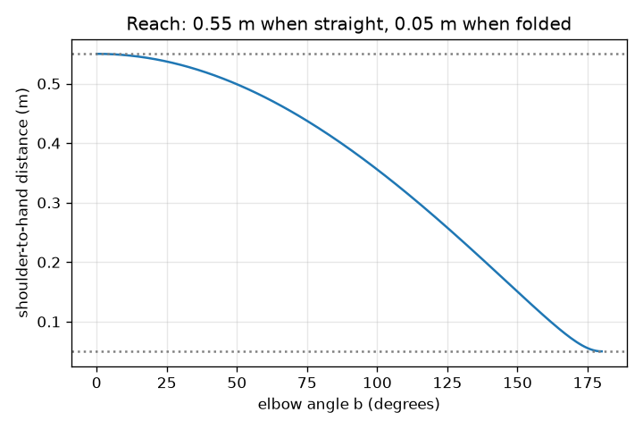
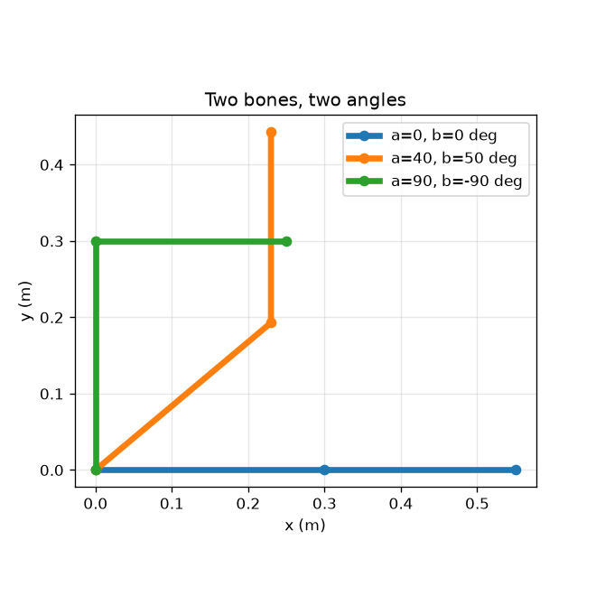

# Session 2: Bones rotate about joints, and joints chain

*Level 2 (mathematical engineering model) · about 75 minutes · openvfx*

> This is a simplified educational model. It is not a validated design tool and must not be used for real structures, electrical installations, vehicles, industrial processes or medical decisions.

**Prerequisites**

- Session 1: rotation matrices.
- The law of cosines is helpful but explained in Section B.

**Learning objectives.** After this session you can:

- Rotate points about a joint that is not at the origin.
- Compute where the elbow and hand are from two joint angles.
- Use the reach formula to find the longest and shortest reach of the arm.
- Solve the inverse problem: which angles put the hand on a target?

## A. Real-world problem
When you wave, your hand travels because your forearm rides on your elbow, which rides on your shoulder. A character rig is exactly that chain of joints. Can a cartoon arm with a 30 cm upper arm and a 25 cm forearm touch a button 35 cm across and 20 cm up? And if so, with what joint angles?

## B. Concept and theory
Each bone turns about its own joint. To rotate about a pivot c, move the pivot to the origin, rotate, and move back. The elbow angle b is measured relative to the upper arm, so the forearm points at the sum a + b: angles add down the chain. The distance from shoulder to hand depends only on b (law of cosines).

| Symbol | Meaning | Unit |
|---|---|---|
| a | shoulder angle from the x axis | degrees |
| b | elbow angle relative to the upper arm | degrees |
| L1 | upper arm length (0.30) | m |
| L2 | forearm length (0.25) | m |
| e, h | elbow and hand positions (x, y) | m |
| c | pivot point of a rotation | m |

**Assumptions**

- Bones are rigid and keep their length.
- Joints turn freely (no joint limits).
- The shoulder is fixed at the origin; everything is in one plane.

$$ \mathbf x'=R(\theta)(\mathbf x-\mathbf c)+\mathbf c $$

$$ \mathbf e=L_1(\cos a,\ \sin a),\qquad \mathbf h=\mathbf e+L_2\big(\cos(a+b),\ \sin(a+b)\big) $$

$$ |\mathbf h|^2=L_1^2+L_2^2+2L_1L_2\cos b $$

## C. Visual explanation
The first figure shows two bones at several joint angles, with the shoulder at the origin. The second plots the shoulder-to-hand distance against the elbow angle: it is largest (0.55 m) when the arm is straight and smallest (0.05 m) when the forearm is folded back, and the curve is flat near both ends because the cosine is flat there.

*Reach against elbow angle: 0.55 m when straight, 0.05 m when folded.*

*Two bones at three poses, in metres.*

## D. Interactive simulation
Run the lesson (`python start.py 2`), then open the live app: [Session 2: a two-bone arm](https://krunalpanchal1995.github.io/openvfx/session-02/) (or `app.html` in this folder). Move the shoulder and elbow sliders and watch the hand, then switch to the reach graph and see that only the elbow angle changes the distance.

**Challenge.** Put the hand on the red target (0.35, 0.20) m, within 1 cm.

## E. Worked example and experiment
**Problem.** With L1 = 0.30 m, L2 = 0.25 m, a = 40 degrees and b = 50 degrees, find the elbow, the hand and the shoulder-to-hand distance.

1. Elbow = 0.30 * (cos 40, sin 40) = 0.30 * (0.766, 0.643) = (0.230, 0.193) m.
2. The forearm points at a + b = 90 degrees, so its offset is 0.25 * (cos 90, sin 90) = (0, 0.25) m.
3. Hand = elbow + offset = (0.230, 0.443) m.
4. Check with the reach formula: |h|^2 = 0.09 + 0.0625 + 2*0.30*0.25*cos 50 = 0.1525 + 0.0964 = 0.2489, so |h| = 0.499 m.
5. Check with the coordinates: sqrt(0.230^2 + 0.443^2) = 0.499 m. The two methods agree.

**Answer.** Elbow (0.230, 0.193) m, hand (0.230, 0.443) m, distance 0.499 m.

**Experiment.** Build the arm from two 30 cm and 25 cm cardboard strips and a pin, set the angles with a protractor, and measure the hand position with a ruler. Expect agreement to about 5 mm. Differences come from pin thickness and protractor reading: the model has zero-width joints, the cardboard does not.

## F. Assessment and design challenge
**Question type A: Conceptual.** Why does the forearm point at angle a + b rather than just b?

Hint

Where is the elbow angle b measured from?

Step-by-step solution

b is measured relative to the upper arm, not relative to the x axis. The upper arm already points at a, so the forearm points at a plus whatever extra turn the elbow adds. Angles accumulate down the chain.

**Question type B: Numerical.** For L1 = 0.30 m, L2 = 0.25 m, a = 90 degrees and b = -90 degrees, find the hand position and its distance from the shoulder.

Hint

The forearm points at a + b = 0 degrees.

Step-by-step solution

Elbow = 0.30 * (0, 1) = (0, 0.30) m. Forearm offset = 0.25 * (1, 0) = (0.25, 0). Hand = (0.25, 0.30) m. Distance = sqrt(0.0625 + 0.09) = 0.391 m. Check: reach formula gives sqrt(0.1525 + 0.15 cos(-90)) = sqrt(0.1525) = 0.391 m.

**Question type C: Graph and simulation interpretation.** From the reach graph, what are the largest and smallest shoulder-to-hand distances, and at which elbow angles?

Hint

Read the highest and lowest points of the curve and the matching x values.

Step-by-step solution

The largest is 0.55 m = L1 + L2 at b = 0 degrees (straight arm). The smallest is 0.05 m = |L1 - L2| at b = 180 degrees (forearm folded back). Both are the ends of the curve, where cos b = 1 and -1.

**Question type D: Design and optimisation challenge.** Design: find joint angles that put the hand on (0.35, 0.20) m. How many solutions are there? Is (1.0, 0.0) m reachable?

Hint

First find b from |h|^2 = 0.35^2 + 0.20^2 using the reach formula, then find a.

Step-by-step solution

|h|^2 = 0.1625, so cos b = (0.1625 - 0.1525) / 0.15 = 0.0667 and b = +86.2 or -86.2 degrees. For each b, a = atan2(0.20, 0.35) - atan2(0.25 sin b, 0.30 + 0.25 cos b): a = -8.5 degrees for b = +86.2 (elbow down) and a = 68.0 degrees for b = -86.2 (elbow up). Two solutions. (1.0, 0.0) is 1 m away but the longest reach is 0.55 m, so it is unreachable.

Score yourself with [RUBRIC.md](../../RUBRIC.md). Print the [activity sheet](activity_sheet.md) to work on paper.

## Common misconceptions
| Common misconception | What is actually true |
|---|---|
| The hand position depends on both angles only through their sum. | The forearm direction depends on a + b, but the hand position depends on a and b separately because the upper arm also moves the elbow. |
| There is exactly one way to reach a point. | Most reachable points have two solutions (elbow up and elbow down); points at full stretch have one. |
| Rotating about a joint is the same as rotating about the origin. | Only if the joint is the origin; otherwise you must shift, rotate and shift back. |

## Glossary
- **joint**: a pivot where one bone turns relative to another
- **forward kinematics**: finding the hand position from the joint angles
- **inverse kinematics**: finding joint angles that put the hand on a target
- **reach**: distance from shoulder to hand

## Finish
1. Do the three coding tasks in [exercises.md](exercises.md).
2. Run `python start.py 2` again after your changes. It ends with the checkpoint; when it prints `PASS`, you are done. (Checkpoint only: `python start.py check 2`.)

Next: [Session 3](../session-03/README.md)
