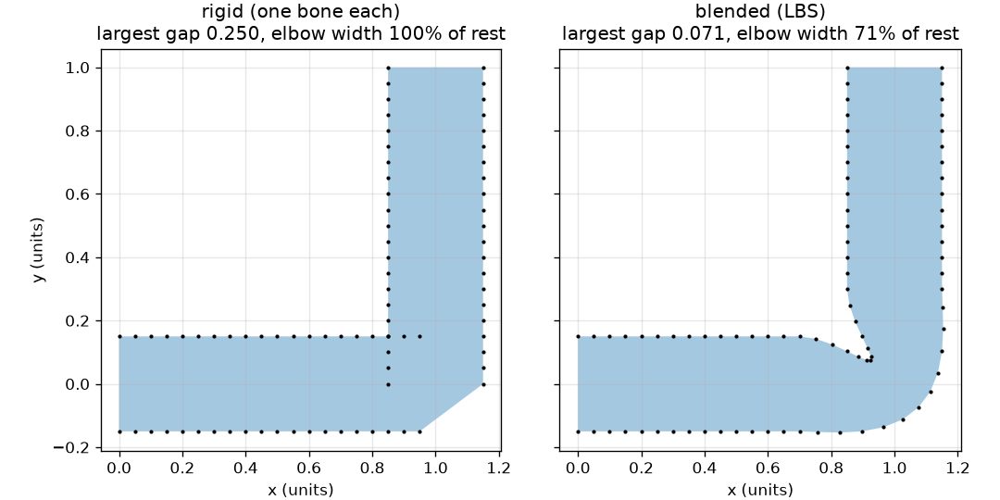
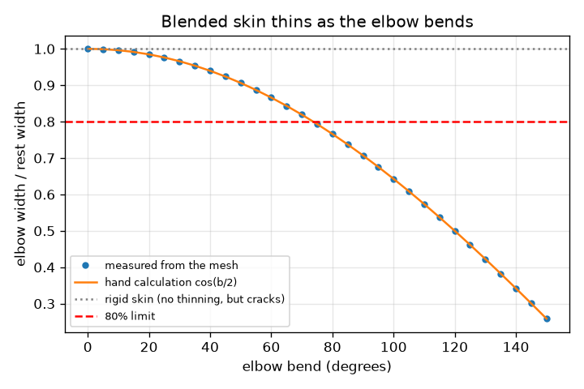

# Session 3: Skin that follows the bones

*Level 3 (simulation and validation) · about 90 minutes · openvfx*

> This is a simplified educational model. It is not a validated design tool and must not be used for real structures, electrical installations, vehicles, industrial processes or medical decisions.

**Prerequisites**

- Session 1: rotation matrices.
- Session 2: rotating about a joint.

**Learning objectives.** After this session you can:

- Explain linear blend skinning: a weighted average of bone motions.
- Measure two skinning defects: cracks (largest gap) and thinning (elbow width).
- Predict the thinning at any bend with a hand calculation, cos(b/2).
- Choose a blend zone and bend range that meet a quality limit.

## A. Real-world problem
A skeleton has no surface. The skin is a cloud of points and each point must decide which bone to follow. If every point follows exactly one bone, the elbow cracks open like a robot's. If points follow a weighted blend of two bones, the skin looks like flesh, but the elbow gets thinner when it bends. Game engines and film studios use this method (linear blend skinning) and fight this thinning every day. Can you measure it, predict it, and keep it within limits?

## B. Concept and theory
Bone 1 stays put. Bone 2 turns by the bend angle b about the elbow. Each skin point has a weight w between 0 and 1 telling how much it follows bone 2. The new position is the weighted average of where bone 1 and bone 2 would put it. Smooth weights (a smoothstep ramp over a blend zone of half-width z) remove cracks. At the elbow w = 1/2, and averaging a point on the top edge with a point on the bottom edge shrinks their distance to cos(b/2) of the rest width.

| Symbol | Meaning | Unit |
|---|---|---|
| b | elbow bend angle | degrees |
| w | weight: how much a point follows bone 2 | no unit |
| z | half-width of the blend zone | units (arm length 2) |
| h | half thickness of the arm (0.15) | units |
| gap | largest distance between neighbouring skin points | units |
| ratio | elbow width divided by rest width (0.30) | no unit |

**Assumptions**

- Two bones and one joint, in a plane.
- Weights vary smoothly along the arm and do not depend on the side of the arm.
- The skin is a row of points along each edge; thickness is measured between matching top and bottom points.

$$ \mathbf v'=(1-w)\,\mathbf v+w\,\big(R(b)(\mathbf v-\mathbf c)+\mathbf c\big) $$

$$ w(x)=3t^2-2t^3,\qquad t=\mathrm{clip}\!\left(\frac{x-(1-z)}{2z},\,0,\,1\right) $$

$$ \text{elbow width ratio}=\cos\!\left(\frac{b}{2}\right) $$

## C. Visual explanation
The first figure bends the arm 90 degrees with two different weightings. With one bone per point the two halves open a visible gap at the elbow; with blended weights the skin is continuous but narrower at the elbow. The second figure plots the measured elbow width ratio against the bend angle. The dots, measured from the mesh, lie exactly on the hand-calculation curve cos(b/2), and they cross the 80 percent limit at about 74 degrees.

*A 90 degree bend: one bone per point (cracks) versus blended weights (thinner elbow).*

*Measured elbow width ratio follows the hand-calculation curve cos(b/2).*

## D. Interactive simulation
Run the lesson (`python start.py 3`), then open the live app: [Session 3: one-bone skin versus blended skin](https://krunalpanchal1995.github.io/openvfx/session-03/) (or `app.html` in this folder). Bend the elbow and compare the two skins, then open the width graph and see where the blue curve crosses the red 80 percent line. Change the blend zone and watch the gap.

**Challenge.** Keep the elbow at least 80 percent as wide as the rest of the arm, with a blend zone of at least 0.2 so the skin does not crack.

## E. Worked example and experiment
**Problem.** For a bend of 90 degrees and half thickness h = 0.15, find the blended elbow width and compare it with the hand-calculation cos(b/2).

1. At the elbow x = 1 the weight is w = 1/2. Bone 1 keeps the top point at (1, 0.15); bone 2 turns it about the elbow to (0.85, 0).
2. Blended top point = average = (0.925, 0.075). In the same way the bottom point blends (1, -0.15) and (1.15, 0) into (1.075, -0.075).
3. Width = distance between them = sqrt(0.15^2 + 0.15^2) = 0.212.
4. Rest width = 2h = 0.30, so the ratio is 0.212 / 0.30 = 0.707.
5. Hand calculation: cos(90 / 2) = cos 45 = 0.707. They agree.

**Answer.** The elbow keeps 70.7 percent of its width; the one-bone skin keeps 100 percent but cracks (largest gap 0.25 against a rest gap of 0.05).

**Experiment.** Cut two overlapping paper strips of equal width, pin them at the middle, and bend them 90 degrees while folding the paper smoothly between them: you will see the paper narrow at the bend, as in the model. A real elbow also has muscle bulging and a helper joint, which this simple model leaves out. Model versus experiment: the model gets the direction (thinning) and the size at one angle right; real characters need more bones.

## Real-world application and mini-project: Rig and animate a waving cartoon arm
A studio hands you a cartoon arm and a four-frame wave: elbow bends of 0, 40, 70 and 40 degrees. The arm must not crack open and must not look thin. Use `lbs_pose` from Session 3 and find the smallest blend zone (in steps of 0.05) for which all four frames pass.

**Deliverable:** A script that prints, for each zone from 0.05 to 0.30, the worst largest gap and the worst elbow width ratio over the four frames, names the smallest passing zone, and saves a four-panel picture of the wave with that zone.

**Success looks like:** The smallest passing zone is reported (it is 0.20), and with it every frame has a largest gap below 0.08 and an elbow width ratio of at least 0.8.

## F. Assessment and design challenge
**Question type A: Conceptual.** Why does averaging the positions from two bones make the elbow thinner, while following a single bone does not?

Hint

Picture the top and bottom points ending up near each other after the two bones turn them in different directions.

Step-by-step solution

Following one bone moves a top point and its matching bottom point by the same rigid motion, so their distance does not change. Averaging two different motions pulls a top point and a bottom point towards the middle: the average of two rotated points is closer to the centre than either, so the distance between them shrinks. Averaging matrices is not a rotation any more.

**Question type B: Numerical.** Use the hand calculation to find the elbow width ratio at a bend of 120 degrees. What width is that for an arm 0.30 thick?

Hint

ratio = cos(b/2).

Step-by-step solution

ratio = cos(60 degrees) = 0.5. Width = 0.5 * 0.30 = 0.15 (units). The elbow has lost half its width, much worse than at 90 degrees.

**Question type C: Graph and simulation interpretation.** On the width graph, at about which bend does the blue curve cross the red 80 percent line? What does that tell an animator?

Hint

Solve cos(b/2) = 0.8.

Step-by-step solution

b/2 = arccos(0.8) = 36.9 degrees, so b = 73.7 degrees. Below about 74 degrees the elbow keeps at least 80 percent of its width; above it, the skin looks visibly pinched. An animator must limit the bend or add helper bones.

**Question type D: Design and optimisation challenge.** Design: choose a blend zone and the largest whole-degree bend so that the elbow keeps at least 80 percent width and the largest gap stays below 0.08. Justify your choice.

Hint

Use lbs_pose(bend, zone) and print the gap and width ratio for a few zones and bends.

Step-by-step solution

Width needs cos(b/2) >= 0.8, so b <= 73.7 degrees: the largest whole-degree bend is 73. At 73 degrees with zone 0.2 the largest gap is 0.075 (below 0.08), so zone 0.2 works; zone 0.15 gives 0.083 at 70 degrees and fails. A safer choice with margin is zone 0.3 and bends up to 70 degrees: width 0.82, gap 0.067. Trade-off: a wider zone reduces the gap but blurs where the elbow is.

Score yourself with [RUBRIC.md](../../RUBRIC.md). Print the [activity sheet](activity_sheet.md) to work on paper.

## Common misconceptions
| Common misconception | What is actually true |
|---|---|
| Smooth weights fix every skinning problem. | They remove cracks but cause thinning at large bends; both defects must be checked. |
| Averaging two rotations gives a rotation. | Averaging two rotation matrices does not give a rotation matrix; it shrinks things. That is the root of the thinning. |
| The blend zone size changes the elbow thinning. | At the elbow the weight is 1/2 for any symmetric zone, so the thinning cos(b/2) does not depend on the zone; the zone changes only the gap. |

## Glossary
- **skinning**: attaching a surface to a skeleton
- **weight**: how strongly a skin point follows a bone, from 0 to 1
- **blend zone**: the stretch of arm over which the weight ramps from bone 1 to bone 2
- **thinning**: loss of width at a bent joint; the 'candy wrapper' look in 2D

## Finish
1. Do the three coding tasks in [exercises.md](exercises.md).
2. Run `python start.py 3` again after your changes. It ends with the checkpoint; when it prints `PASS`, you are done. (Checkpoint only: `python start.py check 3`.)

Next: the [roadmap](../../promo/roadmap.md). Session 4 is yours to build.
